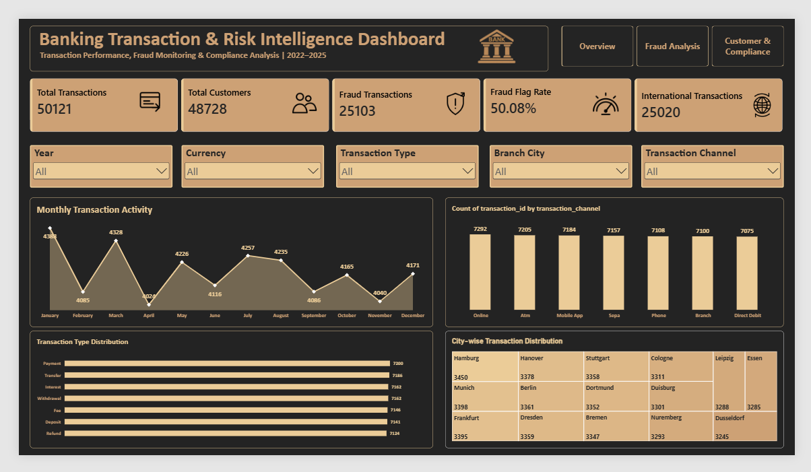
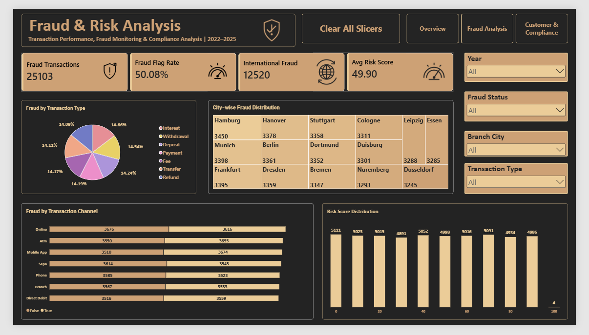
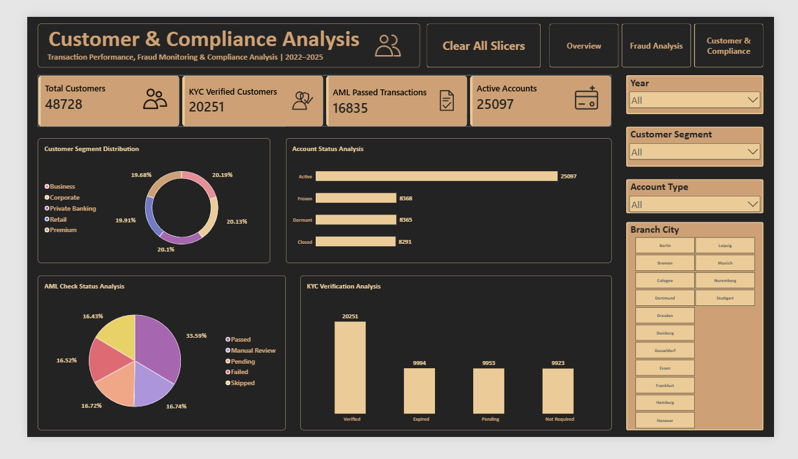

# 🏦 Banking Transaction & Risk Intelligence Dashboard

An interactive Power BI dashboard designed to analyze banking transactions, fraud patterns, customer behavior, and compliance activities from 2022 to 2025.

## 📌 Project Overview

This project focuses on analyzing banking transaction data to understand transaction activities, identify fraud patterns, monitor customer risk, and evaluate compliance performance.

The dashboard contains three interactive pages:

- **Overview:** Banking transaction performance and transaction distribution.
- **Fraud & Risk Analysis:** Fraud transactions, fraud flag rates, international fraud, and risk score distribution.
- **Customer & Compliance Analysis:** Customer segments, account status, KYC verification, and AML check status.

**Power BI File:** `Banking_Transaction_Risk_Intelligence.pbix`

## 📊 Dashboard Features

- Monthly transaction activity analysis.
- Transaction type and channel distribution.
- City-wise transaction analysis.
- Fraud analysis by transaction type and channel.
- Risk score distribution.
- Customer segment analysis.
- Account status monitoring.
- KYC verification analysis.
- AML check status analysis.
- Interactive filters for exploring dashboard data.

## 📈 Key KPIs

| KPI | Value |
|---|---:|
| Total Transactions | 50,121 |
| Total Customers | 48,728 |
| Fraud Transactions | 25,103 |
| Fraud Flag Rate | 50.08% |
| International Transactions | 25,020 |
| International Fraud | 12,520 |
| Average Risk Score | 49.90 |
| KYC Verified Customers | 20,251 |
| AML Passed Transactions | 16,835 |
| Active Accounts | 25,097 |

## 🛠️ Tools & Technologies

- Microsoft Power BI
- Data Visualization
- Business Intelligence
- Interactive Dashboards

## 🖼️ Screenshot

### 1. Banking Transaction Overview

### 2. Fraud & Risk Analysis

### 3. Customer & Compliance Analysis

## 💡 Business Insights

- The dashboard records 50,121 total transactions.
- The fraud flag rate is 50.08%, highlighting the importance of fraud monitoring.
- International transactions account for 25,020 transactions, with 12,520 international fraud transactions.
- Online, ATM, and Mobile App channels show significant transaction activity.
- Customer segments include Business, Corporate, Private Banking, Retail, and Premium.
- Active accounts represent the largest account status category, with 25,097 accounts.
- KYC and AML analysis helps monitor customer verification and compliance activities.

## 👨‍💻 Author

**Subhankar**

Aspiring Data Analyst | Power BI | Data Visualization | Business Intelligence
